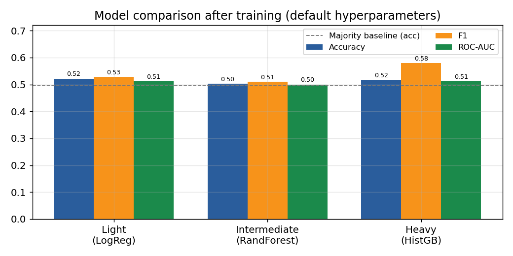
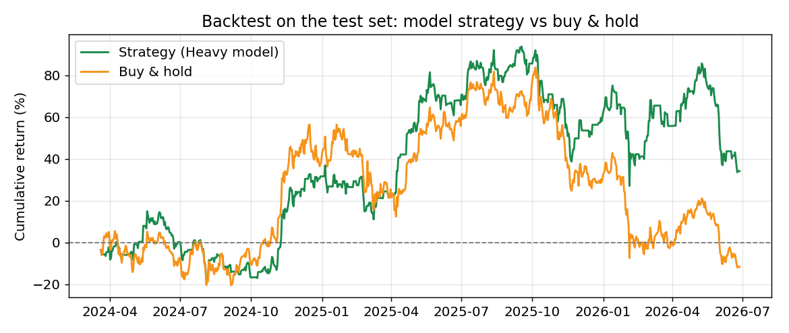
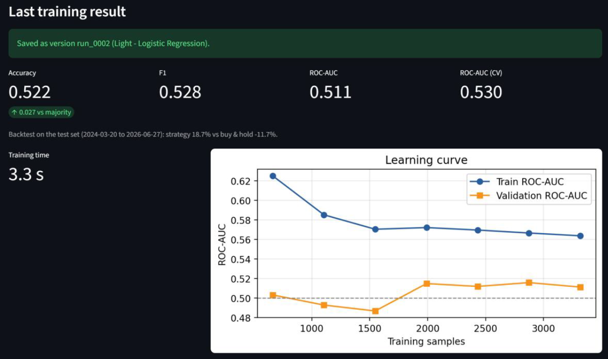
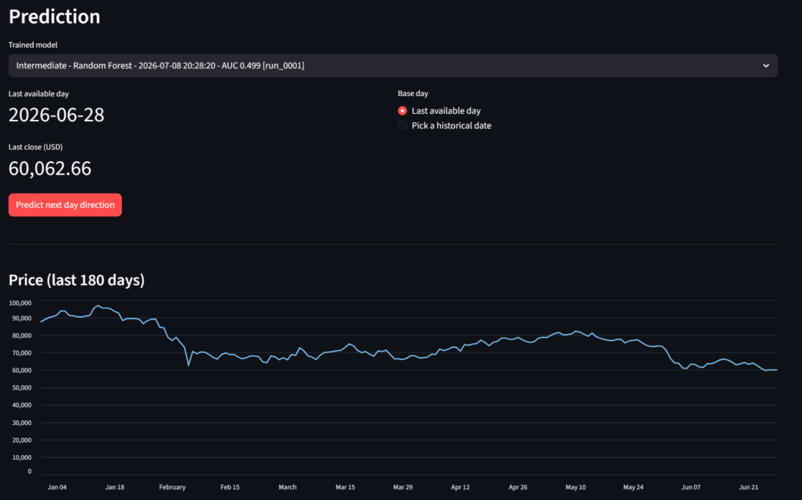

# BTC Direction Predictor

A machine learning application that attempts to predict whether Bitcoin will close higher or lower tomorrow than today. It compares three scikit-learn model families in a Streamlit interface covering data preparation, manual training and AutoML, predictions, model comparison, and prediction history.

An **Artificial Intelligence** assignment in the third year of the BSc in Computer Engineering at ESTG – Polytechnic of Porto (2025/26 special assessment period), reviewed in 2026.

[](https://github.com/fmpoliveira05-jpg/btc-direction-predictor/actions/workflows/ci.yml)

**Try it without installing anything:** [browser demo](https://fmpoliveira05-jpg.github.io/btc-direction-predictor/). Python runs entirely in the browser; first loading takes approximately 20–40 seconds. The demo includes three trained models and a daily data-update workflow.

## Assignment

Select a supervised-learning dataset, analyse and prepare it, train at least three models, justify their evaluation, and build a prediction application. Optional features included model selection, model metrics, prediction history, and adding data to train another version. All are implemented.

## Data and prediction target

- **Source:** [Bitcoin Historical Data](https://www.kaggle.com/datasets/mczielinski/bitcoin-historical-data), with minute-level prices since 2012: approximately 7.6 million rows and 386 MB.
- **Preparation:** resample to daily OHLCV candles, remove data before 2015 (low liquidity and stale prices), and fill missing days.
- **25 features:** current and lagged returns, price/moving-average ratios, volatility, RSI, MACD, Bollinger-band position, daily range, volume change, and weekday. Features use only information available by the end of the day.
- **Target:** `1` if tomorrow's close exceeds today's close, otherwise `0`. Up days represent 52.8% of the training set, so classes are nearly balanced.

Processed daily CSVs are included in `data/`; the large minute-level file is excluded. The Data tab or `python src/data_pipeline.py --kaggle` downloads the public dataset, normally without an account. The last day is discarded because it is still incomplete when the source is updated; keeping it would distort closing price and volume.

## Methodology

Financial time series can produce misleadingly good results, so the evaluation uses:

1. **Chronological split:** February 2015–May 2024 for training (3,388 days), May 2024–September 2026 for testing (848 days), using data through 25 September 2026. No shuffling.
2. **Walk-forward cross-validation:** five `TimeSeriesSplit` folds with a one-day gap, because each day's target depends on the next day's close.
3. **scikit-learn pipelines:** scaling is fitted only to the training portion of each fold.
4. **Training-based selection:** choose hyperparameters and the best model through cross-validation, then evaluate on the held-out test set.
5. **Baselines:** majority class and persistence (tomorrow follows today's direction).
6. **Simple backtest:** buy when the model predicts an increase and remain out otherwise; compare with buy-and-hold.

| Family | Model | Role |
|---|---|---|
| Lightweight | Logistic Regression | Interpretable linear baseline |
| Intermediate | Random Forest | Non-linear model robust to noise |
| Heavier | HistGradientBoosting | Most expressive of the three |

## Results

Recorded results from `python src/train_models.py` with grid-search tuning and data through **25 September 2026**:

| Model | CV ROC-AUC | Test ROC-AUC | Test accuracy | Test backtest |
|---|---|---|---|---|
| Majority class | — | 0.500 | 49.9% | — |
| Persistence | — | 0.499 | 49.9% | — |
| Logistic Regression | 0.537 | 0.502 | 50.7% | +16.0% |
| Random Forest | **0.543** | 0.492 | 50.0% | +26.8% |
| HistGradientBoosting | 0.539 | 0.498 | 50.4% | +20.4% |
| Buy-and-hold | | | | +23.5% |

**None of these models provides useful daily Bitcoin direction predictions on this test set.** Test ROC-AUC values are approximately 0.49–0.50, close to chance. The small cross-validation advantage (0.53–0.54) does not persist in the more recent period. This is consistent with changing feature/target relationships and a difficult prediction problem; it does not establish the cause.

No strategy convincingly outperforms buy-and-hold. Random Forest is slightly ahead in this backtest but has ROC-AUC below 0.5, so that return alone is not evidence of predictive ability.

The results are unstable: using data through June 2026, HistGradientBoosting's backtest returned +34.2% versus −11.7% for buy-and-hold. Three months later, that apparent advantage disappeared.

The project's purpose is to demonstrate careful evaluation: baselines, temporal validation, model selection without using test results, and a critical interpretation of outcomes.

| Model comparison | Test-period backtest |
|---|---|
|  |  |

*These figures come from the original report, with default hyperparameters and an earlier test period. The dated table above contains the later recorded results.*

## Application

```bash
pip install -r requirements.txt
streamlit run app/app.py
```

The English-language interface has five tabs, intended to be used in this order:

1. **Data:** download the latest Kaggle dataset or process a local CSV; inspect preparation; select feature groups; add data rows. A token is requested only if Kaggle requires authentication and is never saved.
2. **Training:** select a family and hyperparameters, or run **AutoML** (random search evaluated through cross-validation). Shows learning curves and elapsed time, supports stopping training locally, and saves each run as a new version.
3. **Prediction:** choose a trained version and obtain next-day direction and probability of an increase, using the latest available day or a historical date.
4. **Comparison:** compare model families before training and hyperparameters/metrics of saved runs afterwards, with best and worst values highlighted.
5. **History:** review predictions, whether they were correct once actual results are known, and cumulative accuracy.

The local application does not include pre-trained models. Users train their own, also avoiding scikit-learn version incompatibilities.

### Browser demo

The [demo](https://fmpoliveira05-jpg.github.io/btc-direction-predictor/) runs the same application through [Stlite](https://github.com/whitphx/stlite): Streamlit on Pyodide, which compiles Python to WebAssembly. GitHub Pages serves static files; no application server is needed.

- Includes three models trained with default hyperparameters by `demo/pretreinar.py`. The versions in `demo/requirements-pretreino.txt` match Pyodide's scikit-learn, NumPy, pandas, and joblib so the `.joblib` files can be loaded.
- Browser training runs in the foreground on one processor, without a stop button. Logistic Regression takes a few seconds; Random Forest approximately half a minute. Reloading loses newly trained models.
- Kaggle downloads work locally; the browser uses processed daily data.
- `demo-pages.yml` downloads data, retrains, and republishes daily; `demo/montar-site.sh` assembles the files. Updates go to the site without repository commits. If Kaggle fails, the repository data is used. `KAGGLE_API_TOKEN` is optional unless authentication becomes necessary.

| Training | Prediction |
|---|---|
|  |  |

*Example screenshots; values depend on data and hyperparameters.*

### Command line

```bash
python src/data_pipeline.py --kaggle                     # Download and generate daily CSVs
python src/data_pipeline.py path/to/btcusd_1-min_data.csv # Process an existing file
python src/train_models.py                              # Train and evaluate all three models
```

## Structure

```text
src/
  features.py       Shared preparation and feature engineering
  modeling.py       Training, evaluation, AutoML, learning curves, and version registry
  data_pipeline.py  Minute-level CSV to daily CSVs
  train_models.py   Grid search and models/metrics.json output
app/app.py          Streamlit application
demo/               Stlite page, pre-trained models, and build scripts
data/               Processed daily data
models/             registry.json for application runs and metrics.json
tests/              pytest tests
docs/figuras/       Report figures
```

## Tests

```bash
pip install -r requirements-dev.txt
pytest
```

The 22 tests check that **features do not use future information** (changing later prices cannot affect earlier features), the target is correct, the incomplete final candle is discarded, train/test order is chronological, all three families train and produce metrics, AutoML can be stopped, and version registration works. A smoke test starts Streamlit without a browser; two further tests check demo-file existence and consistency.

## Changes in the 2026 review

- Best-model selection moved from test-set results to cross-validation, avoiding an optimistic final evaluation.
- Added a one-day train/validation gap.
- Fixed `automl` referencing an unavailable variable and consolidated it with `automl_stoppable`; removed an obsolete save function.
- Replaced machine-specific absolute paths and duplicated CLI logic with project-relative paths and shared modules.
- Handled ROC-AUC for single-class subsets and prevented duplicate run IDs.
- Added automated tests, CI, and this README.
- Added the serverless GitHub Pages demo with daily updates.
- Excluded the incomplete final Kaggle day, made the token optional, and shared minute-file reading between the CLI and application.

## Author

**Francisco Miguel Pereira Oliveira** — [GitHub](https://github.com/fmpoliveira05-jpg)